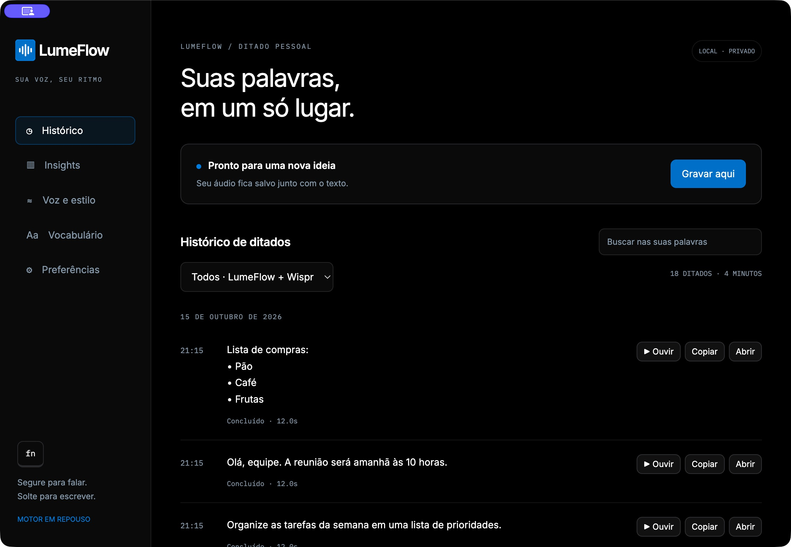
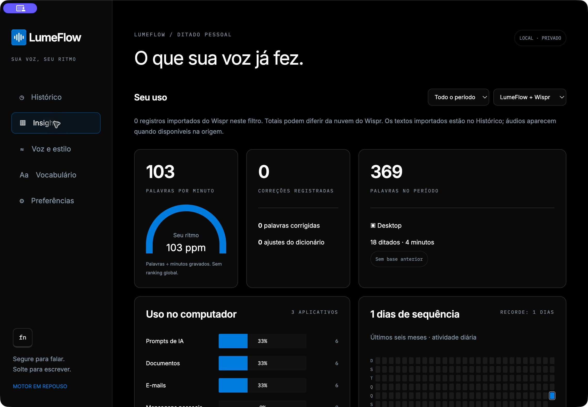
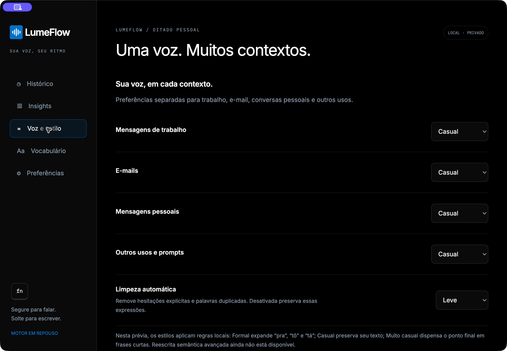
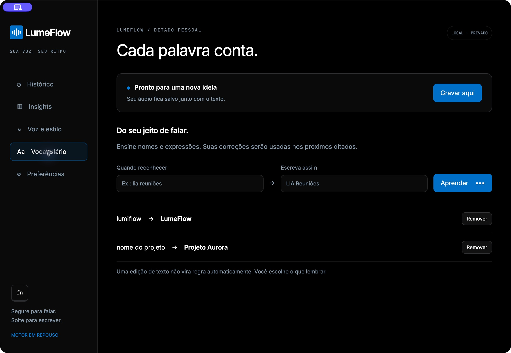
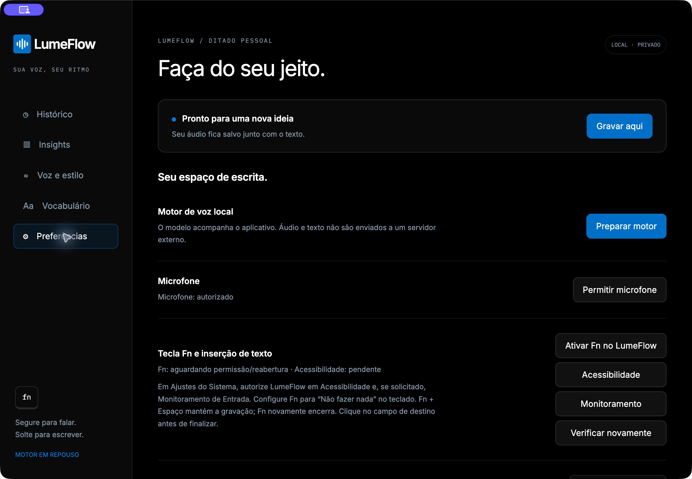

# LumeFlow

Ditado local para macOS, em Electron, com Whisper embarcado. Código MIT.

📚 **[Documentação completa do produto](docs/produto/README.md)** — manual, funcionamento, dados, limitações, diagnóstico e desenvolvimento. Consulte também o **[estado de cada versão](docs/produto/VERSOES.md)** antes de procurar recursos nos instaladores.

**Prévia 0.2.0.** Apple Silicon e Intel são alvos de compilação; testes em hardware Intel e em um segundo Mac ainda precisam ser feitos. macOS 14 ou superior. Não há promessa de funcionamento em qualquer Mac. A distribuição atual usa assinatura ad-hoc, sem notarização Apple.

## Conheça as telas

Capturas reais da versão local 0.2.1 em desenvolvimento, com **dados fictícios de demonstração**. Alguns recursos ainda não estão no instalador público 0.2.0; consulte o [estado das versões](docs/produto/VERSOES.md).

### Histórico: ouvir, copiar e revisar



### Insights: acompanhe seu uso



<details>
<summary>Veja também estilos, vocabulário e preferências</summary>

### Voz e estilo



### Vocabulário pessoal



### Preferências



</details>

## Projeto aberto à comunidade

Você pode modificar e distribuir sua versão sob a licença MIT, ou propor melhorias neste repositório. Faça um fork e envie um **pull request para revisão de @torriani**. As contribuições não são integradas automaticamente. Leia o [guia de contribuição em português](CONTRIBUTING.md).

## Uso

- Segure Fn para falar; solte para encerrar.
- Fn + Espaço: modo fixo. Solte as teclas e continue falando. Fn novamente ou o botão quadrado na barrinha encerra. Confirmado no Mac de desenvolvimento; valide também no seu teclado.
- Esc cancela, preservando o áudio.
- Clique no campo desejado antes de encerrar. O destino é escolhido ao finalizar; se mudar novamente durante o processamento, o texto permanece no histórico para copiar.
- Histórico: Ouvir, Copiar e Recuperar (quando houver áudio de uma gravação sem resultado).
- Preferências: sons, estilo, limpeza de texto, permissões e formato.

**Melhoria 0.2.1 em desenvolvimento, ainda fora da release pública:** o processo **Lume Server** carrega ao iniciar o ditado e encerra após dois minutos sem uso. O primeiro ditado após repouso pode demorar mais; a captura é solicitada sem aguardar o carregamento. Na 0.2.0 publicada o motor permanece carregado.

Áudio e texto são processados localmente. Não exige assinatura, conta, chave de API, Claude ou Codex. O primeiro carregamento do modelo pode levar dezenas de segundos; velocidade varia com hardware. Não é transcrição de reuniões ao vivo.

## Instalar

Veja [guia para alunos](docs/INSTALACAO.md) e [matriz de validação](docs/RELEASE-CHECKLIST.md). Baixe na [prévia experimental](https://github.com/torriani/lume-flow/releases) a arquitetura do seu Mac, extraia e copie LumeFlow.app para Aplicativos. A aplicação e seus modelos ocupam aproximadamente 1 GB, além do histórico pessoal.

## Compilar a partir do código

Requisitos: macOS 14+, Xcode Command Line Tools, Node.js 22.13+ (npm), CMake, Git e Python 3. Em uma pasta nova:

```sh
npm ci
npm test
npm run native
sh scripts/build-engine.sh
npm run models
npm run package
```

Resultado: `build/releases/LumeFlow-darwin-arm64/LumeFlow.app`.
Para Intel, use `export LUME_ARCH=x64` antes dos três comandos de compilação/empacotamento. O compilador normaliza x64 para x86_64. Não misture binários de arquiteturas diferentes; o empacotamento verifica ambos.

O motor é fixado a um commit, as dependências npm têm lockfile e os modelos têm SHA-256 verificado. Isso permite reproduzir a receita de build; não garante binários bit a bit idênticos entre SDKs.

`LUME_SDKROOT` e `LUME_CMAKE` são opções de compilação, não dependências da instalação do aluno. O pacote carrega seus próprios binários e modelos. O workflow em `.github/workflows/build.yml` prepara as duas arquiteturas, mas sua primeira execução foi bloqueada pelo GitHub antes de iniciar os jobs. A validação de CI permanece pendente; veja a matriz de release.

## Privacidade e distribuição

Dados pessoais ficam em `~/Library/Application Support/Lume Flow`, separados do aplicativo e por usuário macOS. Nenhum histórico, dicionário pessoal, áudio, credencial ou configuração do autor é necessário para executar. **Assistente 0.2.1 em desenvolvimento, disponível no código, ainda fora dos instaladores públicos:** na primeira abertura, oferece importar o histórico local do Wispr Flow, somente após confirmação, e permite tentar depois pelo menu LumeFlow → Importar histórico do Wispr Flow. Na 0.2.0 pública, a importação usa ferramentas de desenvolvimento. Textos, estatísticas e áudios disponíveis são copiados sem alterar o original ou duplicar registros; dados existentes somente na nuvem e áudios ausentes não podem ser recuperados por essa importação.

`npm run source` gera `build/LumeFlow-source.zip` por lista permitida de arquivos. Não publique a pasta de trabalho inteira: `.local` contém material privado de desenvolvimento. Não distribua backups pessoais exportados pelo aplicativo.

## Licenças

Código do aplicativo: [MIT](LICENSE). Dependências e modelos: [NOTICE.md](NOTICE.md) e `docs/licenses`. O código não inclui o aplicativo Wispr, seus sons ou seus serviços.
